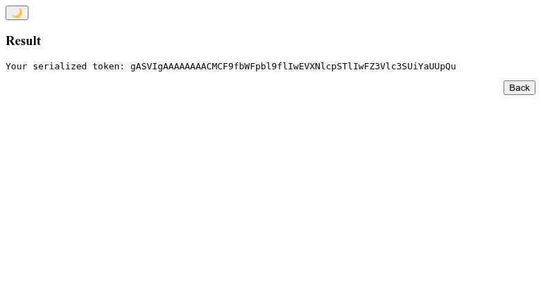
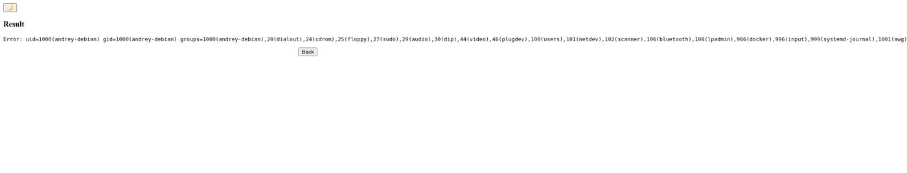
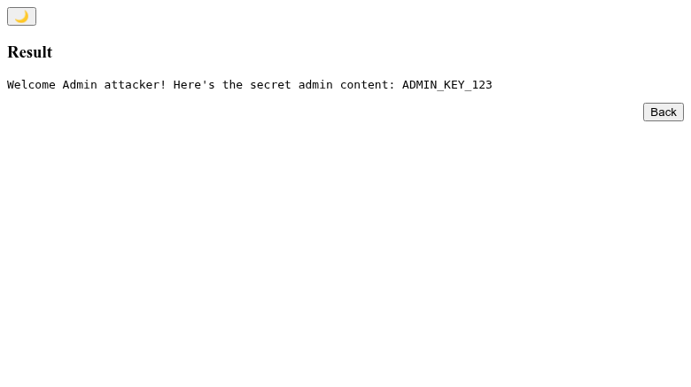

# Unsafe pickle deserialization in PyGoat

**Severity: High (CVSS v3.1: 8.8)**  
**Classification: CWE-502, Deserialization of Untrusted Data**

Lab 5 DevSecOps | Task 4 individual finding | 23 November 2026

I picked the unsafe `pickle.loads()` call in the PyGoat insecure deserialization lab. The app takes a base64 blob from a web form and hands it straight to Python's pickle loader. Bandit marked this as a Medium issue with high confidence. My own score for this code path is much higher, and the CVSS section explains why.

Repository: [Retr0-46/lab5-NCS](https://github.com/Retr0-46/lab5-NCS) | My branch: [KroJIak/lab5-NCS](https://github.com/KroJIak/lab5-NCS/tree/task4-b301-pickle) `task4-b301-pickle`, [pull request #2](https://github.com/Retr0-46/lab5-NCS/pull/2) | Analysed commit: `54d165f`

Affected endpoint: POST /deserialize  
File: dockerized_labs/insec_des_lab/main.py, line 40

## How I found the issue

I scanned the Python code with Bandit 1.9.4, using the same flags as our CI job. The full scan gave 53 findings, 30 of them Medium and 23 High. Then I filtered the results for test B301, which is the Bandit rule for pickle.

```bash
python -m bandit -ll -ii -r . -f json -o /tmp/bandit-full.json
python -m bandit -ll -ii -t B301 -r . -f txt -o reports/task4/bandit-b301.txt
```

The first B301 hit was:

```
Issue: [B301:blacklist] Pickle and modules that wrap it can be unsafe when used to deserialize untrusted data, possible security issue.
   Severity: Medium   Confidence: High
   CWE: CWE-502 (https://cwe.mitre.org/data/definitions/502.html)
   More Info: https://bandit.readthedocs.io/en/1.9.4/blacklists/blacklist_calls.html#b301-pickle
   Location: ./dockerized_labs/insec_des_lab/main.py:40:15
40        user = pickle.loads(decoded_data)
```

A second B301 hit sits in dockerized_labs/software_integrity_lab/app.py, where the same `pickle.loads()` pattern reads a cookie. Both places share the same root problem, so I worked on the insecure deserialization lab.

## Why the code is unsafe

The `deserialize_data()` handler reads the `serialized_data` form field, decodes it from base64 and passes the bytes to `pickle.loads()`.

```python
serialized_data = request.form.get("serialized_data", "")
decoded_data = base64.b64decode(serialized_data)
user = pickle.loads(decoded_data)
```

Pickle is not a data format, it is a small program. When Python reads a pickle it looks for instructions that say "call this function with these arguments", and it runs them. The data itself decides what gets called, so anybody who controls the bytes chooses what the server executes. The only thing standing between the form and the interpreter is base64, which is an encoding and not a protection.

The `try/except` in the handler does not help here. It catches the error after the payload has already run.

## CWE classification

I classify this issue as CWE-502, Deserialization of Untrusted Data. MITRE describes it as the software taking data from an untrusted source and turning it back into objects without checking that the result is valid. Because the format itself can carry instructions, this can lead to code execution and to other unexpected behaviour. Bandit reports the same CWE number for this finding.

I use the CWE rather than a CVE here. This weakness belongs to the language and not to one product, so there is no single CVE that covers it.

## Local validation

I ran the lab on my own machine with Python 3.13.5, Flask 2.0.1 and Werkzeug 2.3.8, bound to loopback on port 8080. Those are the versions I had to install to get the old Flask code to start. The lab's own requirements.txt pins Flask 3.0.0 and Werkzeug 3.0.1, and the patched code was tested with those. I used a browser to work with the forms so the screenshots below show the real page.

First I created a normal user with the Create User form. The app returned a base64 token.



*Figure 1. The app serializes a user object and shows the base64 token.*

Sending that token back to the View Admin Content form worked as intended. The app decoded it, rebuilt the user and told me that only admins can see the secret content. So the normal path is fine.

Then I built my own payload instead of using the token. I made a small class with a `__reduce__` method, which is the hook pickle calls to decide what to run. The `__reduce__` returned the `exec` builtin and a one-line Python snippet.

```python
class Exploit:
    def __reduce__(self):
        return (exec, ("raise Exception(__import__('os').popen('id').read())",))
```

The snippet raises an exception on purpose. The `id` output then travels back to the browser inside that exception message, and the `except` block in the handler puts it on the page. A plain `os.system("id")` would have printed nothing here, because the handler only shows the message it built itself.

I sent the payload to the same form. The server ran the command and the output appeared in the page.



*Figure 2. The response contains the result of `id`, so the command ran inside the Flask process.*

I also did the simpler thing that the lab page itself hints at. I rebuilt the user object with `is_admin` set to True and sent it to the form.



*Figure 3. A forged admin object gives access to the secret content.*

All three requests returned HTTP 200. I kept the server on loopback and stopped the process afterwards.

## Impact and required privileges

An attacker needs network access to the `/deserialize` endpoint. The lab router in challenge/views.py sits behind Traefik ForwardAuth, so in the normal Docker Compose deployment the attacker needs an ordinary PyGoat account. If the service is exposed on its own without that gateway, no account is needed.

Once the payload runs it has the same rights as the Flask process. From there it can read the source code and the config of the app, read or write the files that the process has permission for, take the secrets the app holds and stop the service. The admin case is the mild version. The command execution is the strong one.

In this deployment the process holds the `ADMIN_KEY_123` secret that the admin page shows, and it can rewrite the files of the lab it runs in. A shell as the application user is enough to take over the lab and to reach anything else that runs under the same account.

## CVSS assessment

I score this as CVSS v3.1 8.8, High, for the Compose deployment that the lab ships. That is my own assessment of this code path, not a score that MITRE assigns to CWE-502. I used the FIRST scoring rules.

```
CVSS:3.1/AV:N/AC:L/PR:L/UI:N/S:U/C:H/I:H/A:H = 8.8 (High)
```

| Metric | Value | Reason for this finding |
| --- | --- | --- |
| Attack Vector | AV:N | The attacker sends the payload over HTTP. |
| Attack Complexity | AC:L | No special timing or a race condition is needed. |
| Privileges Required | PR:L | The lab router is behind Traefik ForwardAuth, so an ordinary PyGoat account is needed. |
| User Interaction | UI:N | No other user has to do anything. |
| Scope | S:U | The assessment stays inside the security scope of the application. |
| Confidentiality | C:H | The injected code can read data available to the process. |
| Integrity | I:H | The injected code can change data available to the process. |
| Availability | A:H | The injected code can stop or disrupt the service. |

If the lab container is reachable without the authentication gateway, Privileges Required becomes PR:N and the score is 9.8, Critical. The deployment decides which of the two applies, so I report 8.8 as the score for the lab as it is actually shipped.

Bandit calls the finding Medium. That label describes the rule, which is a list of blacklisted calls, and not the severity of this code path. Here the same pattern gives full command execution, so the score above is much higher.

## Suggested fix

The clean fix is to stop using pickle for data that arrives over HTTP. The lab only needs a username and an admin flag, so JSON works and JSON cannot call functions.

```python
data = json.loads(base64.b64decode(serialized_data))
user = User(username=data["username"], is_admin=bool(data.get("is_admin")))
```

If pickle has to stay, then the bytes need to be signed with a key the server keeps secret. The signature has to be checked before `pickle.loads()` runs. The decoded object has to be checked against an allowlist of expected types. The deserialization should also run in a low privilege process.

The bonus task implements this idea and adds an HMAC-SHA256 signature on top of the JSON. Before and after numbers are in [the bonus report](../bonus/bonus_report.md).

## Verification scope

I tested three things on the vulnerable code, all of them on loopback and all of them returning HTTP 200. The normal user token, the forged admin object and the command execution payload. I did not modify the lab files during the tests and I stopped the server afterwards.

I did not test a container escape, I did not try to escalate privileges on the host, and I did not run the lab behind the real Traefik gateway, so the PR:L value in the vector is based on reading the deployment setup rather than on a measured result. I also did not test the second B301 finding in software_integrity_lab/app.py.

## References

- [Source file at commit 54d165f](https://github.com/Retr0-46/lab5-NCS/blob/54d165fbde62deca2ffc11666842f2a9a34327f2/dockerized_labs/insec_des_lab/main.py)
- [Bandit B301 documentation](https://bandit.readthedocs.io/en/1.9.4/blacklists/blacklist_calls.html#b301-pickle)
- [MITRE CWE-502](https://cwe.mitre.org/data/definitions/502.html)
- [FIRST CVSS v3.1 specification](https://www.first.org/cvss/v3.1/specification-document)
- [OWASP Deserialization Cheat Sheet](https://cheatsheetseries.owasp.org/cheatsheets/Deserialization_Cheat_Sheet.html)
- [The team CI run for this commit](https://github.com/Retr0-46/lab5-NCS/actions/runs/45008357700)
- [CI run of my branch with the fix](https://github.com/KroJIak/lab5-NCS/actions/runs/45153049583)
